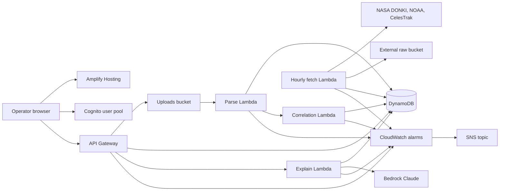

# LaunchPad

Satellite anomaly diagnostic dashboard. An operator uploads a telemetry file with gaps or errors. The app correlates each gap with space weather, orbital position (South Atlantic Anomaly and Earth-shadow eclipse), and software-fault patterns, then shows an independent likelihood for each cause.

Scores are estimates from 0 to 100. Each cause stands on its own: the numbers are not forced to sum to 100. Python computes every score. Claude on Bedrock only explains numbers it is given. The layout always shows: these scores are estimates, not confirmed root causes.

## Architecture



The browser is the Amplify app on `https://main.<app-id>.amplifyapp.com`. That origin is the only one allowed to call API Gateway or POST a telemetry file to S3. Cognito issues the ID token. API Gateway checks it before the read, upload, and explain Lambdas run.

The hourly Lambda reads the NASA key from Secrets Manager, archives raw DONKI, NOAA, and CelesTrak bodies in the external bucket, and writes normalized rows. The parser reads one uploaded object, records gap windows, and invokes correlation. Correlation propagates the cached TLE with SGP4 and writes four CauseScores rows. Explain reads those stored rows and asks Claude for a summary. None of these functions log raw telemetry, TLE lines, the NASA key, or the Bedrock prompt.

## Local setup

Install Node.js 22, Python 3.12, and the AWS CLI v2.

Backend tests:

```bash
cd backend
python3 -m pip install -r requirements-dev.txt
python3 -m pytest
```

Web app:

```bash
cd frontend
npm install
cp .env.example .env
npm run dev
```

Fill `.env` from the CDK outputs after the first deploy. `npm test` and `npm run build` do not need those values. `npm run dev` serves the UI at `http://localhost:5173`.

Infrastructure unit tests:

```bash
cd infra
npm ci
npx cdk synth
npm test
```

The tests mock HTTP, S3, DynamoDB, Secrets Manager, and Bedrock. They do not call AWS.

## Environment variables

The web build reads these. Vite inlines them at build time. Amplify receives the same three from the stack, so a connected repository does not need them typed in by hand.

| Name | Where | Purpose |
|---|---|---|
| `VITE_USER_POOL_ID` | frontend `.env`, Amplify branch | Cognito user pool id |
| `VITE_USER_POOL_CLIENT_ID` | frontend `.env`, Amplify branch | Public SRP app client id |
| `VITE_API_URL` | frontend `.env`, Amplify branch | API Gateway base URL, including the stage, with no extra path |

The Lambdas receive their settings from the stack. Do not put these in the web app.

| Name | Function | Purpose |
|---|---|---|
| `NASA_SECRET_ARN` | hourly fetch | Secrets Manager secret that holds the NASA API key |
| `RAW_BUCKET_NAME` | hourly fetch | External raw and cache bucket |
| `SATELLITES_TABLE_NAME` | fetch, presign, read, explain | Satellites table |
| `SPACE_WEATHER_TABLE_NAME` | fetch, correlate, read, explain | DONKI and NOAA rows |
| `TLE_TABLE_NAME` | fetch, correlate, read, explain | Cached element sets |
| `UPLOADS_BUCKET_NAME` | presign, parser | Telemetry bucket |
| `UPLOADS_TABLE_NAME` | presign, parser | Upload status rows |
| `ANOMALIES_TABLE_NAME` | parser, correlate, read, explain | Gap windows |
| `CAUSE_SCORES_TABLE_NAME` | correlate, read, explain | Four scores per gap |
| `USAGE_TABLE_NAME` | explain | Daily Bedrock call counter |
| `BEDROCK_MODEL_ID` | explain | `anthropic.claude-3-5-sonnet-20241022-v2:0` |
| `BEDROCK_DAILY_LIMIT` | explain | `20` calls per operator per UTC day |
| `MAX_UPLOAD_BYTES` | presign, parser | `5242880` |
| `GAP_INTERVAL_MULTIPLIER` | parser | `2` |
| `DONKI_LOOKBACK_DAYS` | hourly fetch | `7` |

## NASA and AWS credentials

Use an IAM user or IAM Identity Center role for deploys. Do not use the account root keys, and do not commit credentials.

1. In the AWS console, open IAM Identity Center (or IAM, for a single user) and create a principal that can deploy CloudFormation, IAM, Lambda, API Gateway, Cognito, S3, DynamoDB, Secrets Manager, Amplify, Bedrock, CloudWatch, and SNS.
2. Install the AWS CLI and configure it for that principal:

```bash
aws configure
```

`aws configure` asks for an access key id, a secret access key, and a default region. With Identity Center, use `aws configure sso` instead of long-lived keys. `aws sts get-caller-identity` should print the account you intend to deploy into.

The NASA key is separate from AWS:

1. Open [https://api.nasa.gov/](https://api.nasa.gov/) and generate an API key. The shared `DEMO_KEY` is rate limited. Do not use it here.
2. After `cdk deploy`, replace the generated secret. A plain string or `{"api_key":"..."}` both work:

```bash
aws secretsmanager put-secret-value \
  --secret-id <NasaDonkiSecretArn> \
  --secret-string '<your NASA API key>'
```

NOAA SWPC and CelesTrak do not use this secret. In the Bedrock console for the same region, enable Anthropic Claude 3.5 Sonnet. The explain Lambda calls only that model id.

## Deployment

From `infra/`, with the AWS CLI already pointed at the account and region:

```bash
npm ci
npx cdk bootstrap
npx cdk deploy
```

Bootstrap once per account and region. Deploy prints the pool id, client id, API URL, bucket names, table names, NASA secret ARN, Amplify app id, the web origin, and the alarm topic ARN.

The stack creates the Amplify app and the `main` branch, including the Vite build spec and the three `VITE_` variables. It does not store a GitHub token.

1. In the Amplify console, open the `launchpad` app and connect the GitHub repository with the Amplify GitHub App. Use the `main` branch.
2. Start a build. The build runs `npm ci` and `npm run build` in `frontend/` and publishes `frontend/dist`.
3. The site is `https://main.<default-domain>`, which is the `WebOrigin` output. API Gateway and the uploads bucket allow that origin and no other.

Subscribe an address to Lambda error alarms. Confirm the email AWS sends:

```bash
aws sns subscribe \
  --topic-arn <LambdaErrorTopicArn> \
  --protocol email \
  --notification-endpoint you@example.com
```

Create the first satellite row after you know the operator's Cognito `sub`. The hourly TLE fetch only runs for rows that have `noradId`.

```bash
aws dynamodb put-item \
  --table-name <SatellitesTableName> \
  --item '{"satelliteId":{"S":"iss"},"noradId":{"S":"25544"},"ownerSub":{"S":"<cognito sub>"},"name":{"S":"ISS"}}'
```

Operators can sign themselves up. Cognito emails a confirmation code. An admin can still create a user:

```bash
aws cognito-idp admin-create-user \
  --user-pool-id <UserPoolId> \
  --username operator@example.com \
  --user-attributes Name=email,Value=operator@example.com Name=email_verified,Value=true \
  --desired-delivery-mediums EMAIL
```

Passwords are at least 12 characters and include upper case, lower case, a digit, and a symbol. The pool uses Cognito's default email sender, which has a low daily cap.

`cdk destroy` removes the Lambdas, the API, the Amplify app, and the alarms. It leaves the user pool, both buckets, the tables, and the NASA secret in place.

Table keys and IAM details are in [`infra/README.md`](infra/README.md). Scoring weights are in [`backend/src/scoring_weights.json`](backend/src/scoring_weights.json). Sample telemetry is in [`samples/`](samples/README.md).

## What an operator can export

On an anomaly, Download JSON and Download PDF save a report of the gap window, the four scores, the evidence, eclipse intervals, overlapping space-weather events, the latest Kp, and the South Atlantic Anomaly box used for scoring. The report repeats the estimate disclaimer. It does not include TLE lines or raw telemetry.

## Known limitations

- The four scores are estimates, not confirmed root causes. They are not rescaled to sum to 100.
- The South Atlantic Anomaly overlay is the scoring box, 50°S–0° and 90°W–40°E, not a measured contour.
- Eclipse is a cylindrical Earth-shadow test on SGP4 samples. A missing TLE leaves eclipse and the globe unavailable.
- Claude is instructed to use only the supplied numbers, never invent events, say when evidence is weak, and treat telemetry text as data. The service still drops any recommended fix outside watchdog reset, safe mode, EDAC scrubbing, power review, and software patch review. Each operator gets 20 explain or follow-up calls per UTC day.
- Browser calls are allowed only from the Amplify `main` origin. `http://localhost:5173` cannot call the deployed API or upload bucket. A custom domain needs a stack change before the browser will accept it.
- The Amplify app is created without a repository. The first build waits until the GitHub App is connected in the console.
- The alarm topic is created with no subscription. No email arrives until you subscribe and confirm.
- Bedrock calls fail until Claude 3.5 Sonnet is enabled in the deploy region. DONKI calls fail until the NASA secret is replaced. NOAA and CelesTrak keep running when DONKI is down.
- Uploads are CSV or JSON, from 1 byte through 5 MiB. A gap is more than twice the median positive sampling interval. Raw telemetry is not logged and is not part of the export.
- Cognito's default email sender can stop delivering confirmation mail after a small number of messages per day.
- `cdk destroy` does not delete the retained pool, buckets, tables, or NASA secret.
